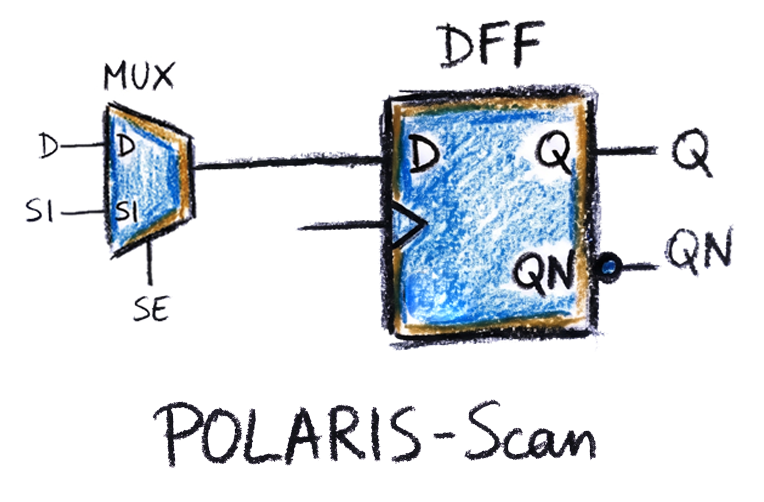

# Polaris-Scan v.0.1
<p align="center">
  
</p>

This guide provides the basic instructions to build, configure, and run the tool.

## Build and Run

To compile and prepare the environment, use the provided Makefile. Run the following commands in your terminal:

```bash
make build
make run
```

## Configuration

Before executing Polaris-Scan, you need to create a TCL configuration file to define the parameters for your run. 

Inside the `Benchmarks` directory you can find examples of TCL files.

This is the configuration for ITC'99 B01 (`b01_15nm.tcl`):

```tcl
set_operation chain
set_liberty /app/Tech/Syn_libraries/15nm/CCS/NanGate_15nm_OCL_typical_conditional_ccs.lib
read_verilog b01_15nm.synth.v
set_output_name b01_15nm.scan.v
set_work_dir log
set_clock clk
```

### Supported TCL Commands

#### Mandatory Commands
| Command | Description |
| :--- | :--- |
| `set_operation chain` | Defines the operation stage to execute (currently `chain`). |
| `read_verilog <file.synth.v>` | Path to the structural synthesized netlist. |
| `set_liberty <file.lib>` | Path to the Liberty standard cell library file. |

#### Optional Commands
| Command | Default | Description |
| :--- | :--- | :--- |
| `set_clock <name>` | `clk` | Name of the primary functional clock port. |
| `set_n_chains <N>` | `1` | Number of parallel scan chains to insert. Flip-flops are balanced across chains to minimize shift depth. |
| `set_output_name <file>` | `<stem>.scan.v` | Destination path/filename for the generated scan netlist. |
| `set_work_dir <dir>` | `log` | Destination directory for logs and profiling reports. |
| `set_sin <name>` | `sin` | Base name for scan-in port(s) (`sin0`..`sin<N-1>` when `n_chains > 1`). |
| `set_sout <name>` | `sout` | Base name for scan-out port(s) (`sout0`..`sout<N-1>` when `n_chains > 1`). |
| `set_shift <name>` | `shift` | Name for the scan enable / shift control port. |
| `set_tck <name>` | `tck` | Name for the dedicated test clock port. |
| `set_test <name>` | `test` | Name for the test mode select port controlling the clock multiplexer. |

### Example: Multiple Scan Chains

To insert 4 parallel scan chains into a design:

```tcl
set_operation chain
set_liberty /app/Tech/Syn_libraries/45nm/lib/NangateOpenCellLibrary_typical.lib
read_verilog cv32e40p_top_45nm.synth.v
set_clock clk_i
set_n_chains 4
set_work_dir log
```

## Execution

Once your tool is built and your `.tcl` script is ready, you can execute Polaris-Scan by passing the configuration file to the main command:

```bash
polaris b01_15nm.tcl
```

## Generated Outputs

Upon successful completion, Polaris-Scan produces:
- `<stem>.scan.v`: Structural Verilog netlist containing the stitched scan chain(s) and clock multiplexer (`__clk_source__ = test ? tck : clk`). The netlist begins with a self-describing JSON metadata header (`POLARIS-Scan METADATA`) recording the flip-flop order and port mappings.
- `<work_dir>/polaris_scan.rpt`: Detailed execution log reporting detected flip-flop families, multiplexer selection, and chaining statistics.
- `<work_dir>/profile.json`: Performance metrics recording wall time, CPU time, and RSS peak memory consumption.

## License & Third-Party Assets

The source code of this project is licensed under the **MIT License** (see the `LICENSE` file for details).

### Nangate 15nm and 45nm Open Cell Library
The standard cell library files located in `Tech/45nm/lib` and in `Tech/15nm/CCS` (used solely to demonstrate and verify this project) are **not** covered by the MIT License. They were developed by Nangate Inc. and are subject to the **Nangate Open Cell Library License, Version 1.0** (see `Tech/45nm/lib/LICENSE`). 

Per the Nangate license terms, these specific files are provided for **non-commercial, academic, and research purposes only**. Commercial use or fabrication using these library files is strictly prohibited without prior permission from Nangate/Silvaco.

### IHP Open Source PDK
Verification and benchmarking were performed using the **IHP Open Source PDK (130nm SG13G2)**, developed by IHP GmbH. 

* **License:** The IHP Open PDK files (located in `Tech/130nm/lib` or linked as a submodule) are licensed under the **Apache License 2.0**, permitting both academic and commercial use.
